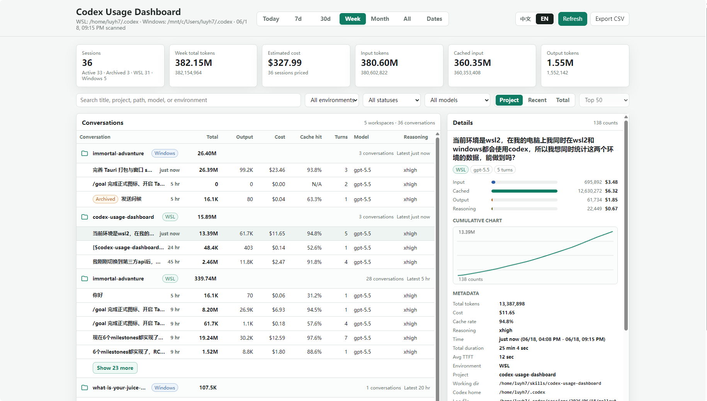

# Codex Usage Dashboard

Codex Usage Dashboard is a Codex-only skill for viewing local OpenAI Codex usage.

It reads your local Codex session logs and opens a browser dashboard for per-conversation usage: total tokens, output tokens, estimated dollar cost, cache hit rate, turns, model, reasoning effort, tool calls, and token-count timeline. It can also import JSON snapshots exported from other devices, so each machine can show local realtime usage plus manually imported remote usage.

> Currently only supports OpenAI Codex. It is not a Claude Code, Cursor, Continue, or generic OpenAI API dashboard.


The dashboard uses a native Rust backend and a Svelte interface at `http://127.0.0.1:8765/`. The classic interface and Python runtime have been removed.

See the [Windows development handoff](docs/development/windows-handoff.md) for checkout, build and verification instructions, and [approved designs](docs/design/README.md) for the UI reference.

## Why This Exists

Most usage tools show daily or project-level totals. This dashboard focuses on the thing Codex users often want to know:

**Which Codex conversation used the most?**

It shows a searchable conversation list and a detail view for each session, including the cost split for input, cached input, output, and reasoning tokens.

## Install With The Skills CLI

Recommended global Codex install:

```bash
npx skills add luyh7/codex-usage-dashboard -g -a codex -y
```

Invoke `$codex-usage-dashboard`, or select **Codex Usage Dashboard** in the skill picker. The skill checks its runtime on every invocation and installs the matching native release when missing or outdated, including after a skills CLI update. This check requires Node 18+; downloads require a published release. The verified executable opens the dashboard at the root URL. Direct native launches need no Node.

## Install With npx

The installer downloads and verifies the native artifact for your platform, then installs the skill. Node 18+ is needed only for installation:


```bash
npx github:luyh7/codex-usage-dashboard
```

Install and create a desktop shortcut:

```bash
npx github:luyh7/codex-usage-dashboard -- --shortcut
```

Install and open immediately:

```bash
npx github:luyh7/codex-usage-dashboard -- --open
```

## Features

- Per-conversation Codex usage from local session logs.
- Default project view, grouped by environment and workspace, with switches for recent and total-token list views.
- Expandable main-agent task rows that show the combined usage of the main agent and its subagents, with nested subagent detail on demand.
- Compact list columns for total tokens, output tokens, cost, cache hit rate, turns, model, and reasoning effort.
- Detail view with token breakdown, estimated dollar cost, and hoverable unit prices for input, cached input, output, and reasoning.
- Effective-dated pricing with per-request GPT-5.6 short/long context tiers. The price history follows the July 30 Terra/Luna reductions and August 21 Sol promotion listed in OpenAI's changelog, so earlier usage keeps its original rate.
- GPT-6 Astra, Sol, Luna and GPT-6.1 Sol pricing, including the 272K input-token context boundary, Fast mode, and Ultrafast mode (6x Standard for Astra and GPT-6.1 Sol). Sol/Luna rates start September 22, 2026; GPT-6.1 Sol rates start September 29, 2026. Official launch dates have no published time, so the dashboard uses UTC midnight. GPT-6 Sol and GPT-6.1 Sol keep distinct cached-input rates ($0.20 and $0.10 per 1M tokens in short context).
- GPT-5.6 Cyber and Daybreak Blue/Red aliases, plus GPT-Rosalind Research/Discovery pricing. Sources: [pricing](https://developers.openai.com/api/docs/pricing), [changelog](https://developers.openai.com/api/docs/changelog), [Ultrafast mode](https://developers.openai.com/api/docs/guides/ultrafast-mode).
- Fast mode detection from each session's recorded service tier, using published model-specific Fast rates (2x for the GPT-5.6 family).
- Fork-aware subagent accounting: inherited parent history is removed from child totals, costs, and timelines instead of being counted again.
- Token-count timeline with latest entries shown first.
- Tool call counts, project path, log file path, and session metadata.
- Local and read-only: reads Codex session logs from one or more local Codex homes; does not modify Codex logs.
- Reads both `.jsonl` and Codex's automatically compressed `.jsonl.zst` histories, including archived logs. Compression and resuming a log preserve usage without counting both file representations twice.
- Reuses unchanged remote snapshots and cached session directory listings. Active logs are checked on every refresh; historical file metadata on Windows drives mounted under WSL is reused for up to two seconds between refreshes. Date filters also check the last event time inside logs whose file modification time is stale. New files, replacements, and archive moves invalidate their directory cache on the next refresh.
- Manual multi-device snapshots: export `cousash-<device-short-code>.json.gz` from one device and import it into another dashboard as remote data. Legacy `.json` snapshots remain supported.
- WSL + Windows support: when running in WSL, automatically merges WSL `~/.codex` with Windows `/mnt/c/Users/<you>/.codex` when present.
- Native builds for Linux, Windows and macOS; a matching platform artifact is required.
- No API key required.

## Installation and Build

The npm installer uses `~/.agents/skills/codex-usage-dashboard`, or
`$CODEX_HOME/skills/codex-usage-dashboard` when `CODEX_HOME` is explicitly set.
The skills CLI may select its own skill location. Inside the installed skill:

```text
SKILL.md
native.json
scripts/install_runtime.mjs     # install/update/readiness check
runtime/codex-usage-dashboard   # .exe on Windows; sole runtime entry
runtime/manifest.json
```

Downloads use the versioned GitHub Release declared in `native.json`, with SHA256
and build identity verification. Missing, unsupported or invalid artifacts fail
installation; there is no Python fallback. A repository checkout alone does not
include generated native artifacts. Until a matching release is published, build
and install locally:

```bash
node tools/package_release.mjs
node bin/install.js --runtime-manifest dist/release/manifest.json --offline
```

Building requires Rust and Node; running the installed binary requires neither.
The build embeds only the Svelte dashboard assets. Build `web/dist` before running Cargo; builds fail when the dashboard assets are missing.
See [release and rollback](docs/implementation/release-and-rollback.md) for
platform acceptance status and offline distribution.

## Launch and Stop

On Linux/macOS with the default npm installation path:

```bash
~/.agents/skills/codex-usage-dashboard/runtime/codex-usage-dashboard
~/.agents/skills/codex-usage-dashboard/runtime/codex-usage-dashboard --stop
```

On Windows, run `runtime/codex-usage-dashboard.exe` from the installed skill.
The default action starts or reuses the background service and opens
`http://127.0.0.1:8765/`. Use `--no-browser` to suppress opening the browser,
`--serve` for a foreground server, or `--shortcut` to create a native desktop entry.
The launcher authenticates managed processes before replacement; an unrelated or
unmanaged listener on 8765 is left running and reported as an error.

## Developer Checks

`cargo test --workspace`, `npm run check --prefix web`, and
`node tools/verify_native.mjs` cover the native implementation. The native verifier
uses an empty PATH to prove launch/export/stop do not invoke Python or Node.
Python is used only by optional historical differential tests under `tools/`,
`tests/`, and `benchmarks/`; their oracle is read from pinned Git history into a
temporary directory and is never installed or used as an application backend.

## Manual Multi-Device Usage

Open the dashboard on the receiving device:

```bash
~/.agents/skills/codex-usage-dashboard/runtime/codex-usage-dashboard
```

Export a snapshot on another device from the dashboard's **Export Snapshot** button, or run:

```bash
~/.agents/skills/codex-usage-dashboard/runtime/codex-usage-dashboard --export-snapshot
```

Dashboard exports display a percentage with preparation, compression and download stages. Percentages follow processed session events and downloaded bytes. Concurrent exports share one job, and an unchanged local snapshot can reuse the completed export.

The export command writes a losslessly compressed JSON file named like:

```text
cousash-mac-9f3a72c1.json.gz
```

Snapshot filenames retain the legacy `cousash-` prefix for compatibility. Compression preserves all statistics, session details and token timeline events. To export uncompressed JSON for an older dashboard, specify an explicit `.json` path with `--export-snapshot snapshot.json`; `/api/export.json` also remains available.

In the dashboard, use **Import Remote Data** to import a `.json.gz` or legacy `.json` file. The server automatically decompresses gzip files; both the upload and decompressed JSON are limited to 512 MiB. The device short code is stored inside the file and is used as the stable identity. Re-importing a newer file from the same device updates that remote data incrementally by session id. If there is no matching remote device yet, the dashboard asks for a display name.

Imported remote snapshots are stored outside the skill directory in the user's application config directory, so reinstalling the skill does not remove them. Remote data can be renamed or deleted from **Manage Remote Data**; deletion is permanent.

To force specific log roots, pass `--codex-home` one or more times:

```bash
~/.agents/skills/codex-usage-dashboard/runtime/codex-usage-dashboard \
  --codex-home ~/.codex \
  --codex-home /mnt/c/Users/<you>/.codex
```

## Data Source

The dashboard reads local Codex logs from each configured Codex home:

```text
~/.codex/sessions
~/.codex/archived_sessions
```

Under WSL, the default scan also includes:

```text
/mnt/c/Users/<you>/.codex/sessions
/mnt/c/Users/<you>/.codex/archived_sessions
```

It parses Codex `token_count` events, including `total_token_usage`, `last_token_usage`, model context window, task timing, and tool calls. It also tracks `thread_settings_applied.thread_settings.service_tier` changes so Fast mode is priced only for the token events recorded after that mode becomes active. When a subagent log omits the tier, it inherits the parent's tier at spawn time until the subagent records its own tier change.

## Privacy

This is a local dashboard. It does not upload your Codex logs. It starts a local server bound to `127.0.0.1`.

## Limitations

- Codex-only: designed for OpenAI Codex Desktop/CLI local session logs.
- Temporary Codex side chats (`ephemeral: true`) are not counted because they do not persist the session logs this dashboard reads. These chats still consume model usage, so dashboard totals exclude that activity.
- Cost is an estimate from public API prices, including the documented Fast mode multiplier, and may not match ChatGPT/Codex subscription billing.
- `codex-auto-review` is shown as $0.00 by dashboard convention; this is not a public API unit price.
- Automatic remote syncing across machines is not included. Multi-device support is manual export/import. WSL + Windows works on the same machine when the Windows profile is mounted under `/mnt/c`.

## Keywords

Codex Usage Dashboard, Codex token usage, Codex per conversation usage, Codex session usage, Codex output tokens, Codex cache hit rate, Codex cost estimate, Codex local logs, Codex skill, OpenAI Codex skill.
