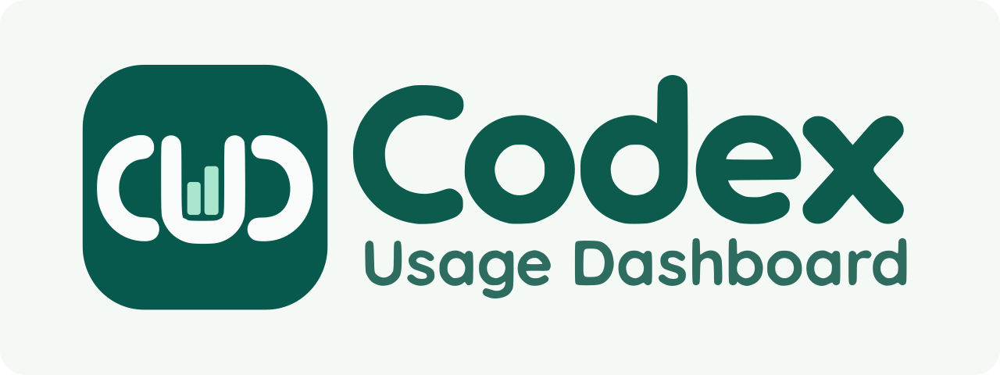
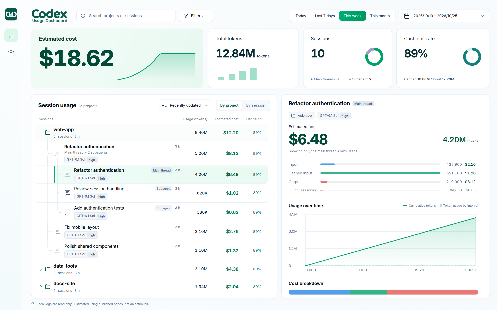

<p align="center">
  <picture>
    <source media="(prefers-color-scheme: dark)" srcset="assets/readme/cud-soft-readme-dark.svg">
    
  </picture>
</p>

<p align="center">
  <strong>See where your Codex tokens go.</strong><br>
  Local session analytics for OpenAI Codex — tokens, estimated costs, and agent activity.
</p>

<p align="center">
  <a href="https://github.com/luyh7/codex-usage-dashboard/releases/latest"></a>
  <a href="https://github.com/luyh7/codex-usage-dashboard/actions/workflows/native.yml"></a>
  <a href="LICENSE"></a>
</p>

<p align="center">
  <a href="#quick-start">Quick start</a> ·
  <a href="#features">Features</a> ·
  <a href="docs/usage.md">Usage guide</a> ·
  <a href="https://github.com/luyh7/codex-usage-dashboard/releases">Releases</a> ·
  <a href="README.zh-CN.md">简体中文</a>
</p>

<p align="center">
  
</p>

<p align="center"><sub>Current interface, shown with demo data.</sub></p>

## Quick start

Install the Codex skill:

```bash
npx skills add luyh7/codex-usage-dashboard -g -a codex -y
```

Then invoke `$codex-usage-dashboard` in Codex, or select **Codex Usage Dashboard** in the skill picker. The dashboard opens at [127.0.0.1:8765](http://127.0.0.1:8765/).

The skill uses **Node.js 18+** to check and install its matching native runtime. Prefer a standalone download? The [native executable](https://github.com/luyh7/codex-usage-dashboard/releases/latest) runs without Node.js, Python, or Rust.

<details>
<summary>More installation options</summary>

### Install and open with npx

```bash
npx github:luyh7/codex-usage-dashboard -- --open
```

This installs the same skill and native runtime. Use `--shortcut` instead of `--open` to create a desktop shortcut.

### Download the executable

Choose an asset from [GitHub Releases](https://github.com/luyh7/codex-usage-dashboard/releases/latest):

| Platform | Filename contains |
| --- | --- |
| macOS · Apple Silicon | `darwin-arm64` |
| macOS · Intel | `darwin-x64` |
| Windows · x64 | `windows-x64` · `.exe` |
| Linux · x64, glibc | `linux-x64` |

On Windows, keep the `.exe` in a permanent folder and run it. On macOS or Linux, rename the downloaded file to `codex-usage-dashboard`, then run:

```bash
chmod +x ./codex-usage-dashboard
./codex-usage-dashboard
```

The program starts in the background and opens your browser. Run the same executable with `--stop` to stop it.

Releases are currently unsigned and not notarized. See the [installation guide](docs/usage.md#standalone-executable) for platform notes, checksum verification, and updates.

</details>

## Features

| Explore | What you can do |
| --- | --- |
| **Find the sessions that matter** | Browse by project or session. Search, filter by date, environment, model, or status, and sort to find the work you want to inspect. |
| **Follow main threads and subagents** | Expand a session group to see each agent's usage. Inherited parent history is removed from child totals to avoid double counting. |
| **Understand token spend** | Inspect input, cached input, and output usage, including reasoning within output. See estimated costs, models, reasoning effort, and tool calls. |
| **See patterns over time** | Daily token usage, cumulative cost trends, cache hit rate, model breakdowns, and a timeline for each session. |
| **Bring devices together** | When running in WSL, include accessible Windows Codex logs, or manually import snapshots from another device. |
| **Read it your way** | English and Chinese, flexible date ranges, and a saved display timezone. |

## Local by design

Your Codex logs stay on your machine. The dashboard reads them without modifying them, requires no API key, and defaults to `127.0.0.1`.

A native **Rust** program serves the embedded **Svelte** interface. It reads active and archived Codex logs, including compressed `.jsonl.zst` histories, and updates the dashboard as local usage changes.

## Across devices

1. On the source device, open **Settings → Device data** and choose **Export this device**.
2. **Transfer** the `.json.gz` file to the receiving device.
3. Open **Settings → Device data** on the receiving device and choose **Import snapshot**.

Re-importing a newer snapshot updates that device's data. Imported snapshots live outside the skill directory, so reinstalling the skill preserves them. This is a manual workflow; see the [snapshot guide](docs/usage.md#multi-device-snapshots) for details.

## Understanding the numbers

Estimated output speed appears in the overview, in usage-value tooltips on the left, and in the final `tok/s` column of the session event table. It reconstructs request windows from logs, excluding tool execution and user idle time where possible. Matching `token_usage_record` timestamps identify response completion; older logs use `token_count`, or the last model output if the counter was delayed until tool completion. Timing starts at the earliest model output's `item_completed.started_at_ms` when available (including reasoning); otherwise it includes first-token wait. Hover or focus the overview speed for coverage of each method. Positive output deltas require a valid window of at least 100 ms with first-token timing, or 1 second without it, and at most 1 hour. There is no minimum output-token count. Aggregates divide total output by total timed duration, follow date/model filters, and exclude duplicate snapshots and inherited history. Unknown timing shows `—`. Log timestamps remain an estimate, especially with buffering or hidden reasoning.

- **Costs are estimates.** They use public API pricing and the model, context, and service tier recorded in the logs. They are not your ChatGPT/Codex subscription bill or remaining quota.
- **Reasoning is part of output.** It is shown as a breakdown, not charged a second time.
- **Coverage follows saved logs.** Temporary `ephemeral` side chats are not included because they do not persist the session logs this dashboard reads.

See [data and pricing](docs/usage.md#data-and-pricing) for historical rates, unknown pricing, and accounting details.

## Documentation

- [Usage guide](docs/usage.md) — installation, launch options, data sources, snapshots, and troubleshooting.
- [Development](docs/development/README.md) — build from source, checks, and release packaging.
- [Release notes](https://github.com/luyh7/codex-usage-dashboard/releases) — what's changed.

## Contributing

[Bug reports and feature requests](https://github.com/luyh7/codex-usage-dashboard/issues) are welcome. Include your OS, dashboard version, and steps to reproduce. To work on the project, start with the [development guide](docs/development/README.md).

## License

[MIT](LICENSE).
