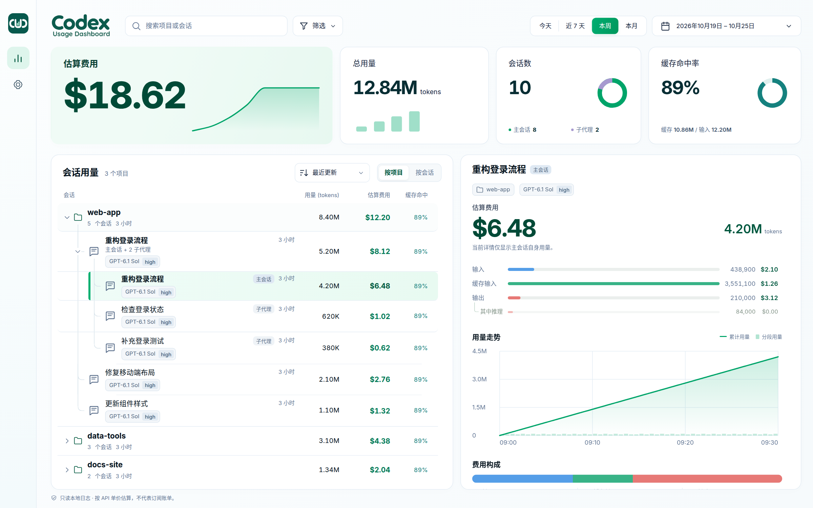

<p align="center">
  <picture>
    <source media="(prefers-color-scheme: dark)" srcset="assets/readme/cud-soft-readme-dark.svg">
    
  </picture>
</p>

<p align="center">
  <strong>看清每个 Codex 会话的消耗。</strong><br>
  在本地查看 Token、估算费用，以及主会话和子代理的用量。
</p>

<p align="center">
  <a href="https://github.com/luyh7/codex-usage-dashboard/releases/latest"></a>
  <a href="https://github.com/luyh7/codex-usage-dashboard/actions/workflows/native.yml"></a>
  <a href="LICENSE"></a>
</p>

<p align="center">
  <a href="#快速开始">快速开始</a> ·
  <a href="#功能">功能</a> ·
  <a href="docs/usage.md">使用指南</a> ·
  <a href="https://github.com/luyh7/codex-usage-dashboard/releases">版本更新</a> ·
  <a href="README.md">English</a>
</p>

<p align="center">
  
</p>

<p align="center"><sub>当前版本界面，截图使用演示数据。</sub></p>

## 快速开始

独立桌面客户端已提供开发构建：[构建与使用](docs/desktop.md) · [平台验证](docs/desktop-verification.md)。Windows、Linux 已有本机测试结果，macOS 保留未验证项。客户端包含原生运行程序，不需要 Skill 或 Agensi 账号。

安装 Codex 技能：

```bash
npx skills add luyh7/codex-usage-dashboard -g -a codex -y
```

然后在 Codex 中调用 `$codex-usage-dashboard`，或在技能列表中选择 **Codex Usage Dashboard**。面板会在浏览器中打开：[127.0.0.1:8765](http://127.0.0.1:8765/)。

通过技能启动需要 **Node.js 18+**，用于检查并安装匹配的原生程序。也可以直接[下载可执行文件](https://github.com/luyh7/codex-usage-dashboard/releases/latest)，运行时无需 Node.js、Python 或 Rust。

<details>
<summary>其他安装方式</summary>

### 使用 npx 安装并打开

```bash
npx github:luyh7/codex-usage-dashboard -- --open
```

该命令安装同一套技能和原生程序。将 `--open` 换成 `--shortcut` 可创建桌面快捷方式。

### 下载可执行文件

从 [GitHub Releases](https://github.com/luyh7/codex-usage-dashboard/releases/latest) 选择对应平台的文件：

| 平台 | 文件名包含 |
| --- | --- |
| macOS · Apple Silicon | `darwin-arm64` |
| macOS · Intel | `darwin-x64` |
| Windows · x64 | `windows-x64` · `.exe` |
| Linux · x64，glibc | `linux-x64` |

Windows 用户将 `.exe` 保存在固定目录后运行。macOS 或 Linux 用户将下载的文件重命名为 `codex-usage-dashboard`，然后执行：

```bash
chmod +x ./codex-usage-dashboard
./codex-usage-dashboard
```

程序会在后台启动，并打开浏览器。使用同一可执行文件加上 `--stop` 可停止服务。

当前发布文件尚未签名或公证。平台说明、校验方法和更新步骤见[安装指南](docs/usage.md#standalone-executable)。

</details>

## 功能

| 功能 | 你可以做什么 |
| --- | --- |
| **找到值得关注的会话** | 按项目或会话浏览，结合搜索、日期范围、环境、模型、状态筛选及排序，定位需要查看的工作。 |
| **追踪主会话与子代理** | 展开会话组，查看每个 Agent 的消耗。子代理继承的父会话历史会被扣除，避免重复统计。 |
| **看懂 Token 花在哪里** | 查看输入、缓存输入、输出及其中推理部分的用量，同时了解估算费用、模型、推理强度和工具调用。 |
| **观察用量变化** | 每日 Token 用量、累计费用走势、缓存命中率、模型构成，以及单个会话的用量时间线。 |
| **汇总不同设备的数据** | 在 WSL 中运行时，可自动纳入可访问的 Windows Codex 日志；其他设备可手动导入快照。 |
| **按自己的习惯查看** | 支持中英文、灵活的日期范围和持久化的显示时区设置。 |

## 数据留在本地

面板只读取 Codex 日志，不修改原始日志，也不自动上传日志。无需 API Key，默认通过 `127.0.0.1` 提供服务。

原生 **Rust** 程序内嵌 **Svelte** 界面，可读取活跃和已归档的 Codex 日志，包括压缩的 `.jsonl.zst` 历史记录，并随本地用量变化更新面板。

## 多设备使用

1. 在来源设备打开**设置 → 设备数据**，选择**导出本机快照**。
2. 将 `.json.gz` 文件**传到接收设备**。
3. 在接收设备打开**设置 → 设备数据**，选择**导入快照**。

再次导入同一设备的新快照会更新其数据。已导入快照保存在技能目录之外，重新安装技能也会保留。这是手动导出、导入流程，详见[快照指南](docs/usage.md#multi-device-snapshots)。

## 如何理解这些数字

- **费用是估算值。** 根据公开 API 单价及日志记录的模型、上下文和服务档位计算，不代表 ChatGPT/Codex 订阅账单或剩余额度。
- **推理用量属于输出。** 作为输出中的细分展示，不会再次计费。
- **统计范围取决于已保存的日志。** 临时的 `ephemeral` side chat 不保存本面板读取的会话日志，因此不在统计范围内。

历史价格、未知定价和统计口径见[数据与计价说明](docs/usage.md#data-and-pricing)。

## 文档

- [使用指南](docs/usage.md) — 安装、启动参数、数据来源、快照与常见问题（英文）。
- [开发指南](docs/development/README.md) — 源码构建、检查和发布打包（英文）。
- [版本记录](https://github.com/luyh7/codex-usage-dashboard/releases) — 每个版本的变化。

## 参与贡献

欢迎提交 [Bug 和功能建议](https://github.com/luyh7/codex-usage-dashboard/issues)。反馈问题时请附上操作系统、面板版本和复现步骤。参与开发请先阅读[开发指南](docs/development/README.md)。

## 许可证

[MIT](LICENSE)。
